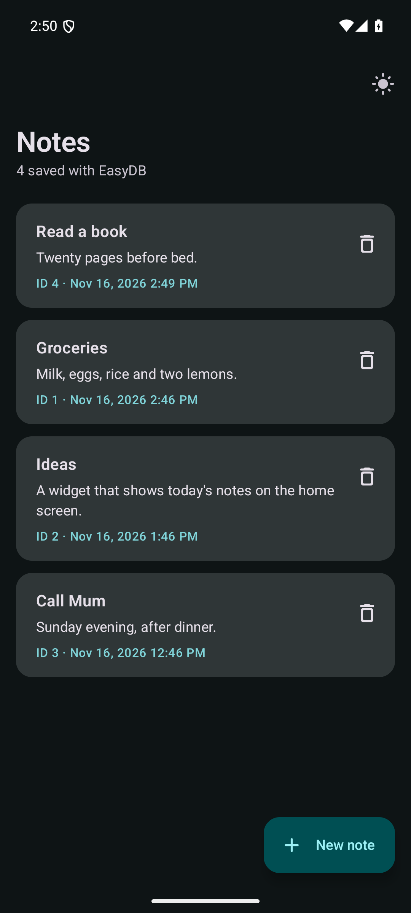
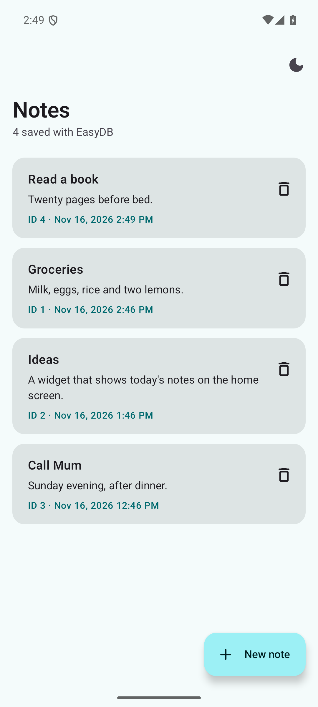

# AndroidEasySQL-Library

[](https://jitpack.io/#p32929/AndroidEasySQL-Library)

A small SQLite library for Android. Create a table, then add, read, update and delete rows in a few chained calls, without writing SQL or a `SQLiteOpenHelper` of your own.

Version 2.0.0 is rewritten in Kotlin for modern Android, works the same from Java, and adds a few things that make it nicer to use: read every row as a simple list, count rows, and store `Long` and `Double` values.

## Screenshots

The sample app is a small notes app built with this library.

| Light | Dark |
|---|---|
|  |  |

## Why use it

1. **No SQL to write.** You describe the columns once, and the library builds the table.
2. **An `ID` column for free.** Every table gets an auto-increment primary key.
3. **Chained calls.** Add or update a whole row in one line.
4. **Works from Kotlin and Java.**
5. **Tiny.** No extra dependencies, Android 5.0 (API 21) and up.

## Install

Add JitPack to your repositories in `settings.gradle.kts`:

```kotlin
dependencyResolutionManagement {
    repositories {
        google()
        mavenCentral()
        maven("https://jitpack.io")
    }
}
```

Add the dependency:

```kotlin
dependencies {
    implementation("com.github.p32929:AndroidEasySQL-Library:2.0.0")
}
```

## Usage (Kotlin)

```kotlin
// 1. Create the database and the table once, and keep the object.
val db = EasyDB.init(context, "Notes")
    .setTableName("Notes")
    .addColumn("Title", "text", "not null")
    .addColumn("Body", "text")
    .addColumn("Edited", "integer")
    .doneTableColumn()

// 2. Add a row
db.addData("Title", "Groceries")
    .addData("Body", "Milk and eggs")
    .addData("Edited", System.currentTimeMillis())
    .doneDataAdding() // true if saved

// 3. Read every row as a list of maps (newest first, ordered by column 3)
val notes = db.getAllRows(3, false)
notes.forEach { println("${it["ID"]}: ${it["Title"]}") }

// 4. Update the row with ID 1
db.updateData("Title", "Shopping").rowID(1)

// 5. Delete the row with ID 1
db.deleteRow(1)
```

## Usage (Java)

```java
EasyDB db = EasyDB.init(context, "Notes")
        .setTableName("Notes")
        .addColumn("Title", "text", "not null")
        .addColumn(new Column("Body", "text"))
        .doneTableColumn();

boolean saved = db.addData("Title", "Groceries").addData("Body", "Milk and eggs").doneDataAdding();

List<Map<String, Object>> rows = db.getAllRows();

boolean updated = db.updateData(1, "Shopping").rowID(1);
boolean deleted = db.deleteRow(1);
```

## All the calls

1. **Set up:** `init`, `setTableName`, `addColumn`, `doneTableColumn`, `getAllColumns`.
2. **Add:** `addData(column, value)` for each column, then `doneDataAdding()`. A column can be its name or its number (1 is your first column).
3. **Read:**
   1. `getAllRows()` returns a list of maps.
   2. `getAllData()` and `getAllDataOrderedBy(columnNumber, ascending)` return a `Cursor`.
   3. `getOneRowData(id)` and `searchInColumn(column, value, limit)` return a `Cursor`, or `null` when nothing matches. Pass limit `-1` for every match.
   4. `matchColumns(columns, values)` tells you if a row has all those values.
   5. `count()` returns the number of rows.
4. **Update:** `updateData(column, value)` for each column, then `rowID(id)`.
5. **Delete:** `deleteRow(id)`, `deleteRow(column, value)` and `deleteAllDataFromTable()`.

Values can be `String`, `Int`, `Long`, `Double` or `null`. Close any `Cursor` you get back when you are done with it.

## Migrating from 1.x

Most 1.x code works without changes. A few things are different:

1. The minimum Android version is now 5.0 (API 21), up from 4.0.3.
2. `deleteRow(column, value)` now returns `true` when it deleted one or more rows. Before, it returned `false` if more than one row matched, even though they were deleted.
3. `searchInColumn` with a limit of `0` now returns every match. Before, it returned nothing.
4. `getOneRowData(column, value)` is deprecated. Use `searchInColumn(column, value, 1)`.
5. The library now uses the application context, so it no longer holds on to your Activity.

If you need a version that still supports older Android, keep using `1.4.1`.

Using Flutter? The same idea is on pub.dev as [easiestdb](https://pub.dev/packages/easiestdb).

## License

MIT License — Copyright (c) 2018 Fayaz Bin Salam. See [LICENSE](LICENSE) for the full text.

## Contributing

Contributions are warmly welcomed and greatly appreciated! Whether it's a bug fix, new feature, or improvement, your input helps make this project better for everyone.

Before submitting a pull request, please:

1. Create an issue describing the feature or bug fix you'd like to work on
2. Wait for discussion and approval to ensure alignment with project goals
3. Fork the repository and create your feature branch
4. Submit your pull request with a clear description of changes

This approach helps avoid duplicate efforts and ensures smooth collaboration. Thank you for considering contributing!

## Share

Sharing this repository with your friends is just one click away from here

[](https://www.facebook.com/sharer/sharer.php?u=https://github.com/p32929/AndroidEasySQL-Library/)
[](https://twitter.com/intent/tweet?url=https://github.com/p32929/AndroidEasySQL-Library/)
[](https://www.tumblr.com/share?v=3&u=https://github.com/p32929/AndroidEasySQL-Library/)
[](https://getpocket.com/save?url=https://github.com/p32929/AndroidEasySQL-Library/)
[](https://pinterest.com/pin/create/button/?url=https://github.com/p32929/AndroidEasySQL-Library/)
[](https://www.reddit.com/submit?url=https://github.com/p32929/AndroidEasySQL-Library/)
[](https://www.linkedin.com/shareArticle?mini=true&url=https://github.com/p32929/AndroidEasySQL-Library/)
[](https://api.whatsapp.com/send?text=https://github.com/p32929/AndroidEasySQL-Library/)

---

## Support

If this saved you time, you can buy me a coffee — it keeps these projects maintained and free.

[](https://www.buymeacoffee.com/p32929)

**Sponsor a mention** — $499 one-time: your name + link in this section for 3 months. **$1,200 one-time:** featured placement at the top of this section, plus a pinned mention on [my X profile](https://x.com/p32929), for 3 months. Email **[fayazdevinbox@uberip.com](mailto:fayazdevinbox@uberip.com)** for an invoice.

<!-- hire-block -->

---

## 💼 Using this at a company?

I do fixed-price delivery work on my own projects. One invoice, one date, no hourly billing:

| | |
|---|---|
| **White-label build** — this project rebranded, extended and deployed as yours | **$6,500** · 3 weeks |
| **Custom app from scratch** on my own stack, signed and auto-updating | **$12,500** · 6 weeks |
| **Production-hardening sprint** — 72 hours on this project, for your load and your security review | **$999** |
| **Ongoing capacity** — one project-week of my time reserved every month | **$9,000 / month** |

Full details → **[p32929.github.io/hire](https://p32929.github.io/hire/)** · Email **[fayazdevinbox@uberip.com](mailto:fayazdevinbox@uberip.com)** — scoping and quotes are free and I answer within one business day.
